# Online Bookstore: Design and Implementation Report

CSCE 310 project. The source code, setup steps and tests are in the repository (see `README.md`).

**Contents**
1. [Overview](#1-overview)
2. [Database design](#2-database-design)
3. [Backend design: REST API](#3-backend-design-rest-api)
4. [Frontend design: screens](#4-frontend-design-screens)
5. [Architecture and class design](#5-architecture-and-class-design)
6. [Requirements coverage](#6-requirements-coverage)

---

## 1. Overview

Customers search a catalog and buy or rent books in one order. Each order produces an HTML bill.
Managers see all orders, mark them paid, take back rented books, manage the catalog, and run sales
reports.

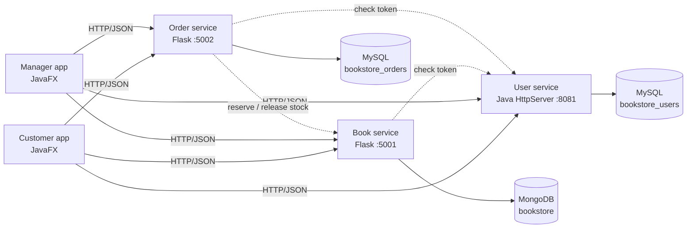

**Key decisions**

| Decision | Why |
|---|---|
| Each service owns its own data. The user and order services use separate MySQL schemas and never read each other's tables. | Services can change their storage without breaking each other, as the 3-service split in the spec intends. |
| Login gives a random token. The user service stores only its SHA-256 hash in a `sessions` table. The other services check a token by calling `GET /api/users/me`. | One place decides who is logged in. Logging out ends the session in every service at once (FR2). A stolen database doesn't leak usable tokens. |
| Orders copy the book's title, author and price at the moment of purchase. | Bills stay correct after a manager edits a book's price. The order service can print a bill without calling the book service. |
| Stock is taken with one MongoDB update per book that only succeeds if enough copies are left (`copies >= qty`). If any book fails, the ones already taken are put back. | Two customers can never both get the last copy, and an order is all or nothing. |
| Renting is a line type (`BUY` / `RENT`) with a due date 30 days after the order. A manager marks a rental *returned*, which puts the copy back in stock. | FR7 says "buy and/or rent in a single transaction". Returns are what make renting different from cheaper buying. |
| Every desktop network call is asynchronous (`CompletableFuture`), and results come back on the JavaFX thread. | The window never freezes (N2). |

---

## 2. Database design

The system has two MySQL schemas and one MongoDB database. Relationships that cross databases are
stored as plain ids (marked *logical* below), since no database can enforce a foreign key into
another.

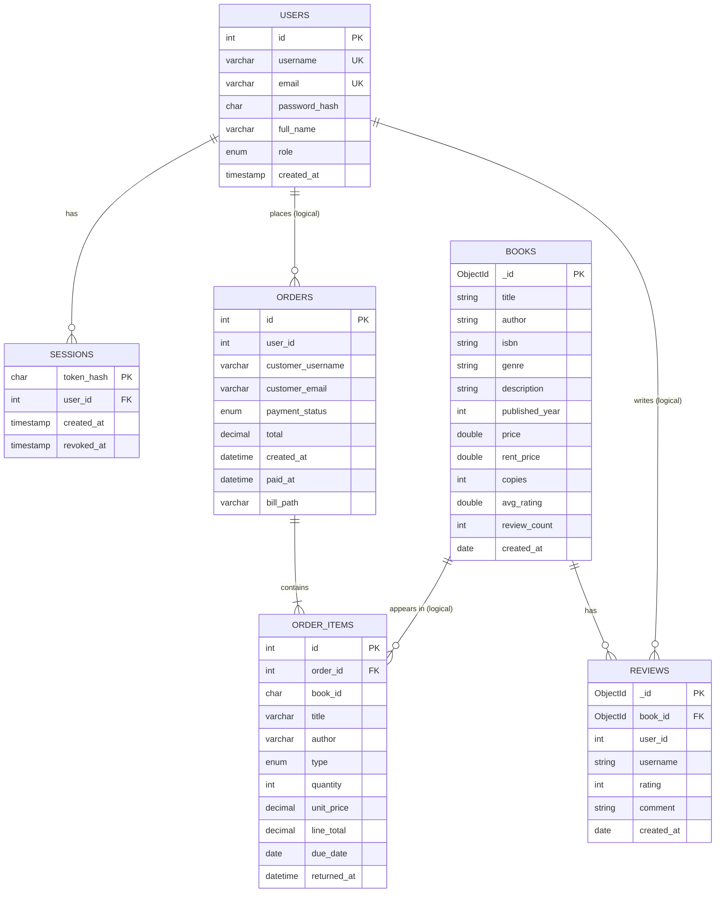

### 2.1 MySQL `bookstore_users` (user service)

**users**: one row per account.

| Attribute | Type | Rules / meaning |
|---|---|---|
| id | INT, auto | Primary key |
| username | VARCHAR(30) | Unique; 3–30 letters, digits or `_` |
| email | VARCHAR(255) | Unique; must look like an email |
| password_hash | CHAR(60) | bcrypt hash, cost 10 (N3). The password itself is never stored. |
| full_name | VARCHAR(100) | Optional |
| role | ENUM('CUSTOMER','MANAGER') | Sign-up always makes `CUSTOMER`. The manager account is created at first start. |
| created_at | TIMESTAMP | Set by the database |

**sessions**: one row per login.

| Attribute | Type | Rules / meaning |
|---|---|---|
| token_hash | CHAR(64) | Primary key; SHA-256 of the token given to the client |
| user_id | INT | Foreign key → users.id, cascade delete |
| created_at | TIMESTAMP | Login time |
| revoked_at | TIMESTAMP NULL | Set on logout. A session is active while this is NULL. |

### 2.2 MySQL `bookstore_orders` (order service)

**orders**: one row per order (transaction).

| Attribute | Type | Rules / meaning |
|---|---|---|
| id | INT, auto | Primary key; the order number on the bill |
| user_id | INT | The customer's id in the user service (*logical* link) |
| customer_username, customer_email | VARCHAR | Copied at order time, for the bill and email |
| payment_status | ENUM('PENDING','PAID') | Starts `PENDING`; changed by a manager (FR13) |
| total | DECIMAL(10,2) | Sum of the order's line totals |
| created_at | DATETIME (UTC) | Order time; indexed for date-range reports |
| paid_at | DATETIME NULL | Set when marked PAID |
| bill_path | VARCHAR(500) | Where the HTML bill is saved (FR9) |

**order_items**: one row per book line in an order.

| Attribute | Type | Rules / meaning |
|---|---|---|
| id | INT, auto | Primary key |
| order_id | INT | Foreign key → orders.id, cascade delete |
| book_id | CHAR(24) | MongoDB id of the book (*logical* link); indexed for best-seller reports |
| title, author | VARCHAR(255) | Copied at order time |
| type | ENUM('BUY','RENT') | Bought or rented |
| quantity | INT | 1–20 |
| unit_price | DECIMAL(10,2) | Buy price or rent price at order time |
| line_total | DECIMAL(10,2) | unit_price × quantity |
| due_date | DATE NULL | RENT only: order date + 30 days |
| returned_at | DATETIME NULL | RENT only: set when the manager marks it returned |

### 2.3 MongoDB `bookstore` (book service)

**books** collection: one document per title. Indexed on `title` and `author`.

| Field | Type | Meaning |
|---|---|---|
| _id | ObjectId | Primary key (sent to clients as the string `id`) |
| title, author | string | Required; what search matches against (FR4) |
| isbn, genre, description | string | Optional |
| published_year | int | Optional |
| price | double | Buy price |
| rent_price | double | Price to rent for 30 days |
| copies | int | Copies in stock; changed by orders, returns and managers |
| avg_rating, review_count | double, int | Kept up to date whenever a review is written |
| created_at | date | When added |

**reviews** collection: one per (book, customer). The unique index on `{book_id, user_id}` means writing again replaces
the earlier review.

| Field | Type | Meaning |
|---|---|---|
| _id | ObjectId | Primary key |
| book_id | ObjectId | → books._id |
| user_id, username | int, string | The reviewer (*logical* link to users) |
| rating | int | 1–5 |
| comment | string | Optional, up to 2000 characters |
| created_at | date | Last written |

**Why MongoDB for books:** books have optional, uneven fields (description, ISBN, ratings), and the
catalog is read far more than it is written. A document per book with its rating summary embedded
answers search and detail screens in one read.

---

## 3. Backend design: REST API

### 3.1 Conventions

- Request and response bodies are JSON (`Content-Type: application/json`), except the bill, which is HTML.
- Protected endpoints need `Authorization: Bearer <token>`. The token comes from login (N4).
- Every error has the same shape, with a matching HTTP status:
  ```json
  { "error": "Not enough copies of \"Dune\" (2 left, 5 requested)" }
  ```

| Status | Meaning |
|---|---|
| 400 | Bad input (missing field, bad email, quantity out of range…) |
| 401 | No token, unknown token, or logged-out token |
| 403 | Logged in, but the wrong role (e.g. a customer calling a manager endpoint) (N5) |
| 404 | Not found, including another customer's order (it isn't revealed that it exists) |
| 409 | Conflict: username/email taken, out of stock, rental already returned |
| 503 | A service this one depends on is down |

**Auth column key:** *none* = public, *any* = any logged-in user, *customer* / *manager* = that role only,
*service* = the service-to-service key header `X-Service-Key`.

### 3.2 User service: `http://localhost:8081`

| Method | URL | Auth | Purpose |
|---|---|---|---|
| POST | `/api/auth/register` | none | Create a customer account (FR3) |
| POST | `/api/auth/login` | none | Log in and get a token (FR1) |
| POST | `/api/auth/logout` | any | End this session (FR2) |
| GET | `/api/users/me` | any | Who this token belongs to. Also how the other services check tokens. |
| PUT | `/api/users/me` | any | Change email / full name (profile) |
| PUT | `/api/users/me/password` | any | Change password |

**POST /api/auth/register**
```json
// request
{ "username": "bob", "password": "bob12345", "email": "bob@example.com", "full_name": "Bob Reader" }
// 201 response
{ "user": { "id": 3, "username": "bob", "email": "bob@example.com", "full_name": "Bob Reader",
            "role": "CUSTOMER", "created_at": "2026-11-19T19:20:11Z" } }
```

**POST /api/auth/login**: `role` is optional. When given, other roles are refused with 403. The
customer app sends `CUSTOMER` and the manager app sends `MANAGER` (FR11).
```json
// request
{ "username": "alice", "password": "alice123", "role": "CUSTOMER" }
// 200 response
{ "token": "lE2QmGWWMDXUoeBBge5-tb7f8hAITF_GLeBbqJMVQ8c",
  "user": { "id": 2, "username": "alice", "email": "alice@bookstore.test", "full_name": "Alice Customer",
            "role": "CUSTOMER", "created_at": "2026-11-19T18:10:44Z" } }
```

**POST /api/auth/logout**: no body. Returns `{ "message": "Logged out" }`.

**GET /api/users/me**: returns `{ "user": { …same shape as above… } }`.

**PUT /api/users/me**: `{ "email": "new@example.com", "full_name": "Alice C." }` → `{ "user": {…} }`

**PUT /api/users/me/password**: `{ "current_password": "alice123", "new_password": "newpass1" }` →
`{ "message": "Password changed" }`

### 3.3 Book service: `http://localhost:5001`

| Method | URL | Auth | Purpose |
|---|---|---|---|
| GET | `/api/books?q=<keyword>` | any | Search title or author; blank `q` lists all (FR4, FR5) |
| GET | `/api/books/<id>` | any | One book |
| POST | `/api/books` | manager | Add a book (FR14) |
| PUT | `/api/books/<id>` | manager | Change any fields of a book, e.g. copies (FR14) |
| GET | `/api/books/<id>/reviews` | any | Reviews, newest first |
| POST | `/api/books/<id>/reviews` | customer | Write or replace your review |
| POST | `/internal/stock/reserve` | service | Take copies out of stock, all or nothing |
| POST | `/internal/stock/release` | service | Put copies back |

**Book object** (in every response that returns books):
```json
{ "id": "673cf0a2b1e4c2a1d0f3e9a1", "title": "Dune", "author": "Frank Herbert", "isbn": null,
  "genre": "Science Fiction", "description": null, "published_year": 1965,
  "price": 18.99, "rent_price": 5.5, "copies": 9, "avg_rating": 4.5, "review_count": 2 }
```

**GET /api/books?q=austen** → `{ "books": [ {book}, {book}, … ] }`. The match is case-insensitive and
partial, on title or author. Special characters are treated literally.

**POST /api/books**: required `title`, `author`, `price`, `rent_price`, `copies`. The rest are optional.
```json
// request
{ "title": "Project Hail Mary", "author": "Andy Weir", "price": 24.99, "rent_price": 6.99,
  "copies": 3, "genre": "Science Fiction", "published_year": 2021 }
// 201 response
{ "book": { …book object… } }
```

**PUT /api/books/<id>**: any subset of the same fields, e.g. `{ "copies": 20 }` → `{ "book": {…} }`

**POST /api/books/<id>/reviews**
```json
// request
{ "rating": 4, "comment": "Great world-building." }
// 201 response: the review, plus the book with its new average
{ "review": { "id": "…", "book_id": "…", "user_id": 2, "username": "alice", "rating": 4,
              "comment": "Great world-building.", "created_at": "2026-11-19T19:14:40.245000+00:00" },
  "book": { …book object… } }
```

**POST /internal/stock/reserve** (order service only)
```json
// request
{ "items": [ { "book_id": "673cf0…", "quantity": 2 }, { "book_id": "673cf1…", "quantity": 1 } ] }
// 200 response: the books with their current prices
{ "books": [ {book}, {book} ] }
// 409 if any book is short. Nothing is taken in that case.
```

### 3.4 Order service: `http://localhost:5002`

| Method | URL | Auth | Purpose |
|---|---|---|---|
| POST | `/api/orders` | customer | Place an order of bought and/or rented books (FR6, FR7, FR8) |
| GET | `/api/orders/mine` | customer | Your order history |
| GET | `/api/orders/<id>` | any | One order (customers: only their own) |
| GET | `/api/orders/<id>/bill` | any | The bill as an HTML page (FR8, FR9) |
| GET | `/api/orders?status=&from=&to=` | manager | All orders, optionally filtered (FR12) |
| PATCH | `/api/orders/<id>/payment` | manager | Set payment status (FR13) |
| POST | `/api/orders/<id>/items/<itemId>/return` | manager | Mark a rented book returned and restock it |
| GET | `/api/reports/sales?from=&to=` | manager | Sales summary for a period |
| GET | `/api/reports/bestsellers?from=&to=&limit=` | manager | Top books by copies sold + rented |

`from` / `to` accept a date (`2026-11-01`) or an ISO date-time (`2026-11-01T05:00:00Z`). `to` is
exclusive. The manager app sends the local day boundaries converted to UTC.

**POST /api/orders**
```json
// request
{ "items": [ { "book_id": "673cf0…", "type": "BUY",  "quantity": 2 },
             { "book_id": "673cf1…", "type": "RENT", "quantity": 1 } ] }
// 201 response
{ "order": {
    "id": 1, "user_id": 2, "customer_username": "alice", "customer_email": "alice@bookstore.test",
    "payment_status": "PENDING", "total": 35.48,
    "created_at": "2026-11-19T19:16:02+00:00", "paid_at": null,
    "items": [
      { "id": 1, "book_id": "673cf0…", "title": "1984", "author": "George Orwell", "type": "BUY",
        "quantity": 2, "unit_price": 14.99, "line_total": 29.98, "due_date": null, "returned_at": null },
      { "id": 2, "book_id": "673cf1…", "title": "Dune", "author": "Frank Herbert", "type": "RENT",
        "quantity": 1, "unit_price": 5.5, "line_total": 5.5, "due_date": "2026-12-19", "returned_at": null } ] } }
```
Placing an order reserves stock, saves the order in one database transaction, writes
`bills/order-<id>.html`, and starts emailing the bill in the background (FR10). If saving fails, the
stock is released.

**GET /api/orders/mine** and **GET /api/orders** → `{ "orders": [ {order}, … ] }`, newest first.

**GET /api/orders/<id>/bill** → `text/html`, a complete printable page (see screenshot 5).

**PATCH /api/orders/<id>/payment**: `{ "payment_status": "PAID" }` → `{ "order": {…} }`. The saved bill
is rewritten so it shows the new status.

**POST /api/orders/<id>/items/<itemId>/return**: no body → `{ "order": {…} }`. Returns 400 for a bought
line and 409 if the rental was already returned.

**GET /api/reports/sales?from=2026-11-01&to=2026-12-01**
```json
{ "from": "2026-11-01", "to": "2026-12-01", "order_count": 2, "revenue": 59.97,
  "paid_revenue": 39.48, "pending_revenue": 20.49, "units_bought": 3, "units_rented": 2,
  "orders": [ {order}, … ] }
```

**GET /api/reports/bestsellers?limit=10**
```json
{ "books": [ { "book_id": "673cf2…", "title": "The Hobbit", "author": "J. R. R. Tolkien",
               "units_bought": 2, "units_rented": 0, "revenue": 35.98 }, … ] }
```

---

## 4. Frontend design: screens

Both apps are native JavaFX desktop programs (not web pages). They share one stylesheet, a login
screen, and a bill window.

### Customer app

| | |
|---|---|
| 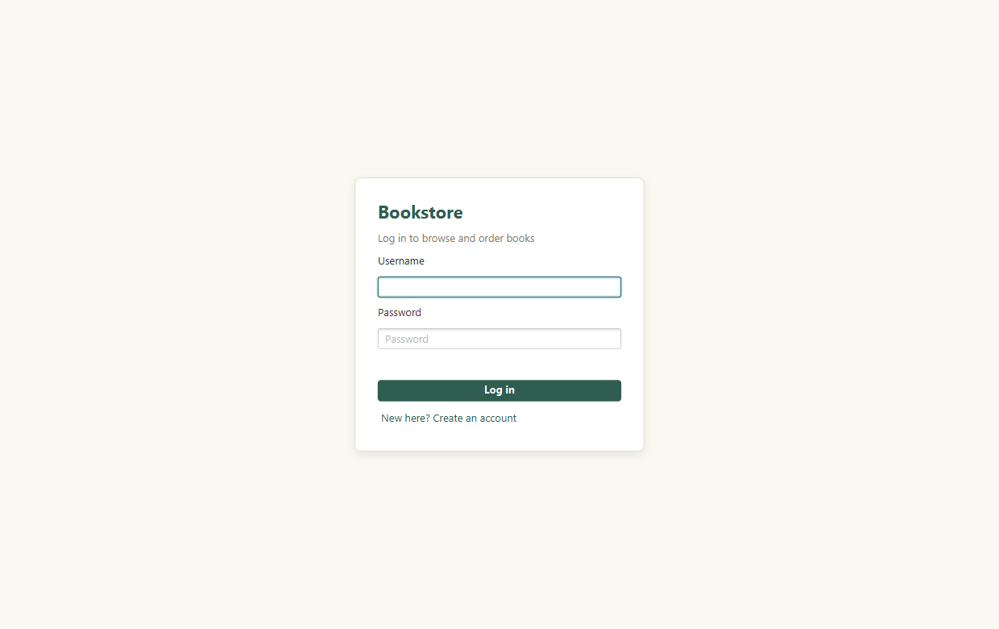 **1. Login (FR1).** The link opens sign-up. | 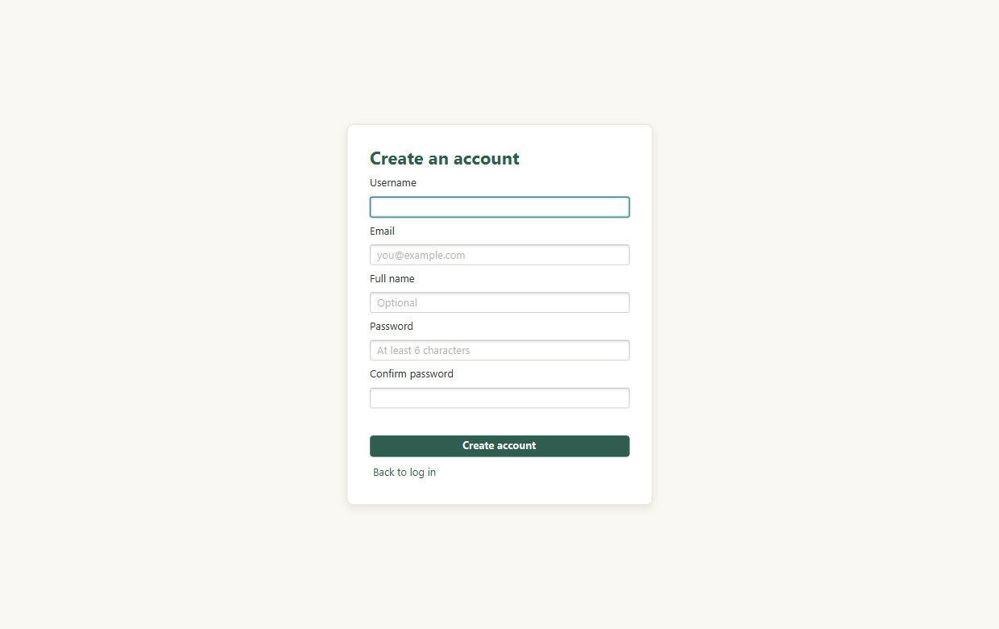 **2. Sign up (FR3).** On success it logs straight in. |
| 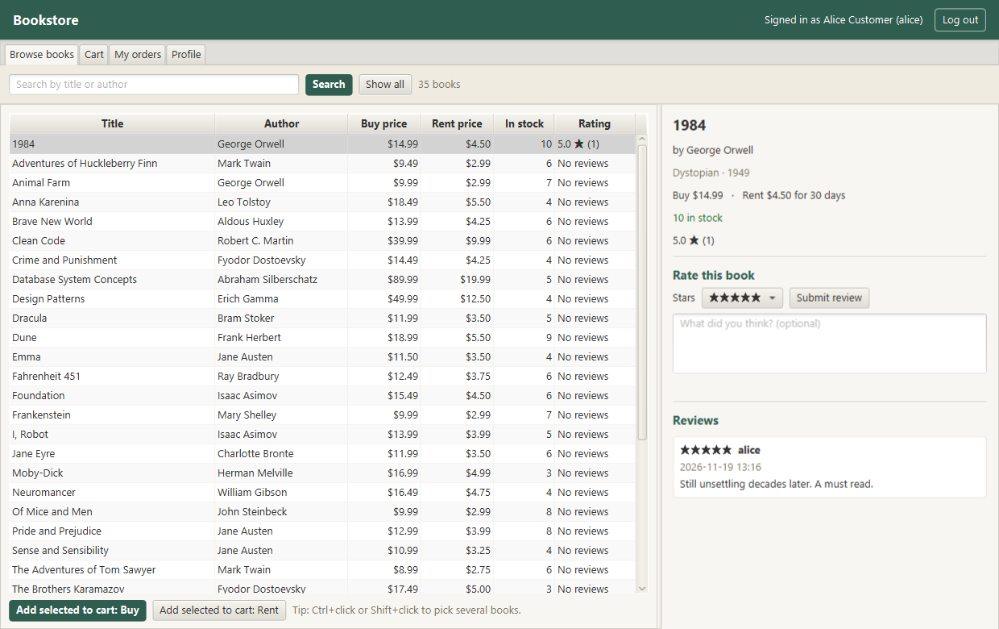 **3. Browse and search (FR4–FR6, reviews).** Search box, results with title, author, prices, stock and rating. Pick one or more rows and add them to the cart as Buy or Rent. The right side shows the selected book with its reviews and a form to rate it. | 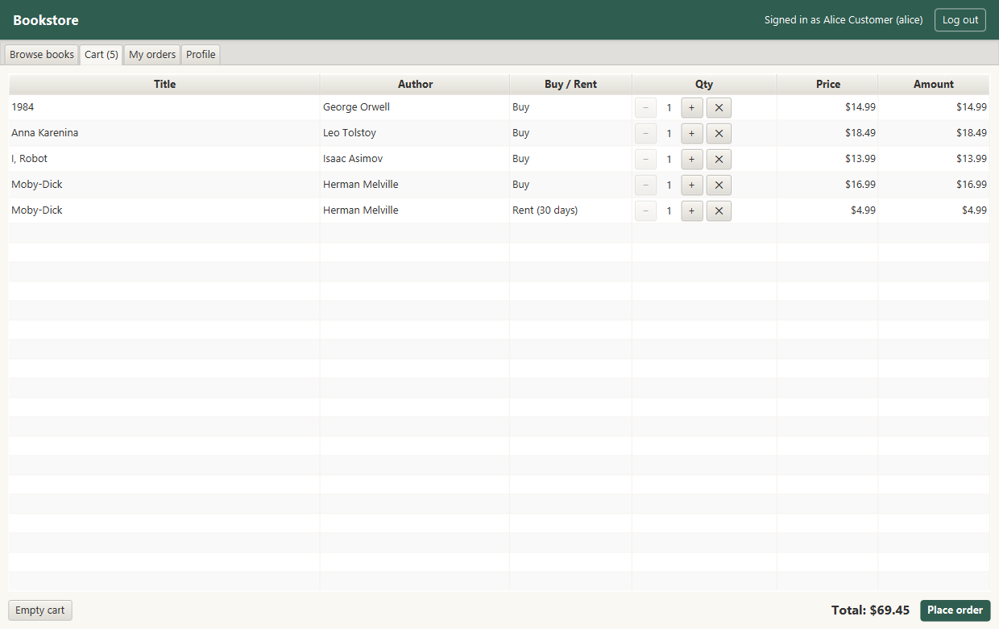 **4. Cart (FR7).** Bought and rented lines, quantity +/−, remove, running total, *Place order*. |
|  **5. Bill (FR8, FR9).** Opens after ordering. Order number, items, Buy/Rent, prices, rental due date, total. *Print…* and *Save as HTML…* buttons. | 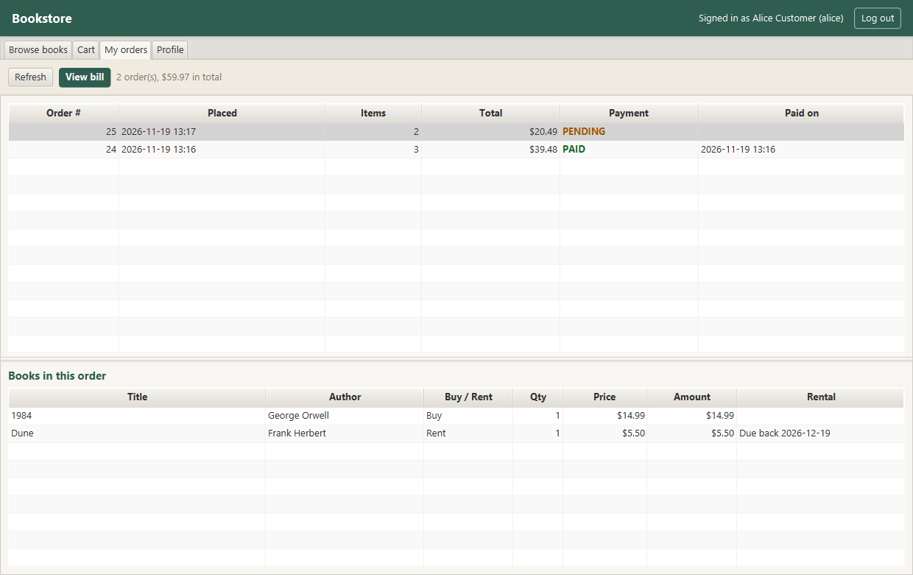 **6. My orders (order history).** Every order with status; the selected order's books below; *View bill*. |
| 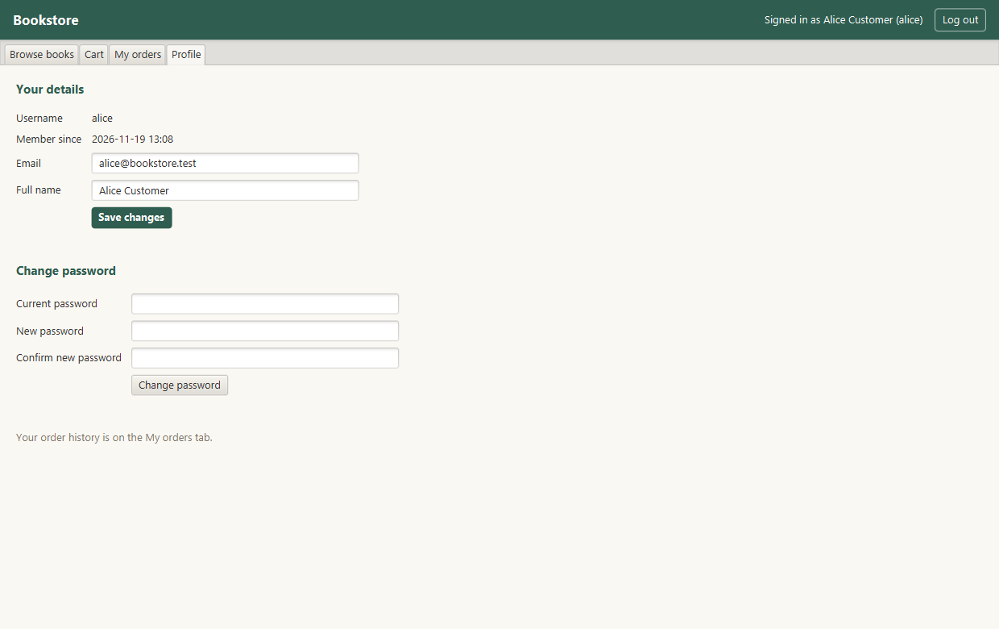 **7. Profile.** Change email, name and password. | |

### Manager app

| | |
|---|---|
| 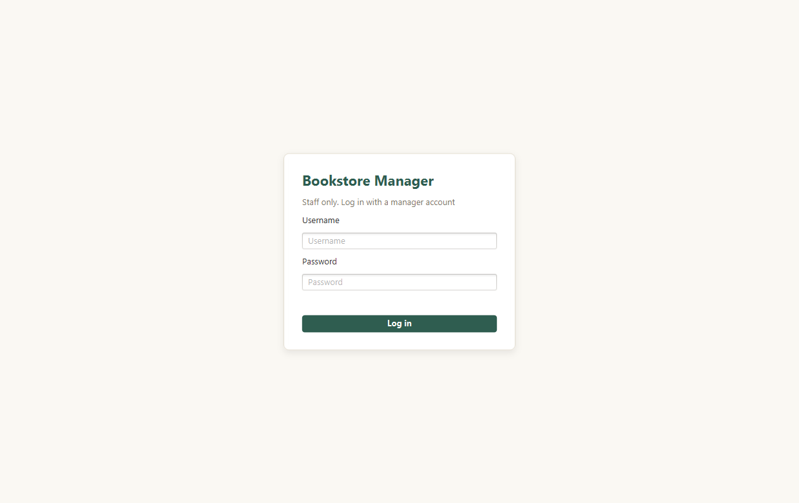 **8. Manager login (FR11).** Accepts manager accounts only. | 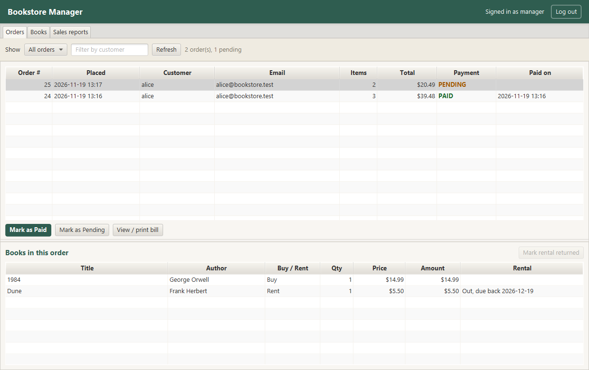 **9. Orders (FR12, FR13).** All orders, filter by status or customer. *Mark as Paid / Pending*, *View / print bill*. Below: the order's books, with *Mark rental returned*. |
| 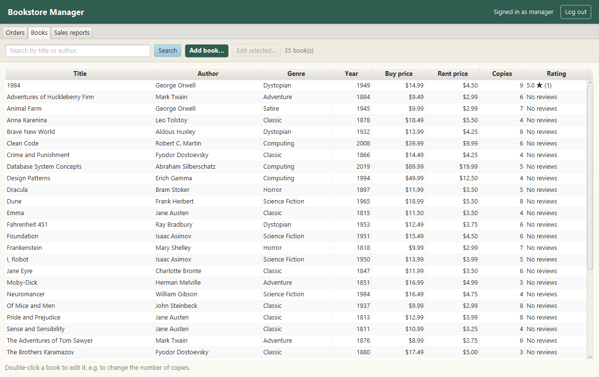 **10. Books (FR14).** Search the catalog, *Add book…*, double-click or *Edit selected…* to change any field, e.g. copies. | 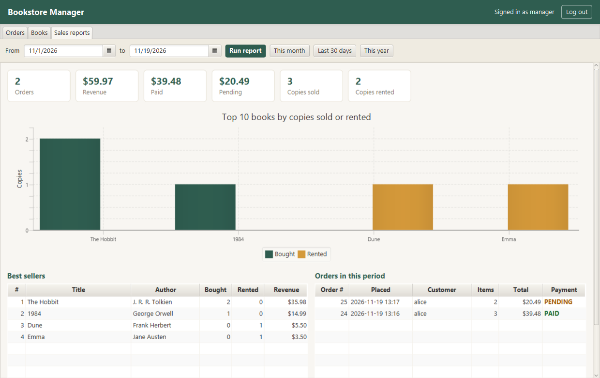 **11. Sales reports.** Date range with shortcuts, totals, a best-seller chart, the best-sellers table, and the orders in the period. |

---

## 5. Architecture and class design

### 5.1 Patterns used

- **Client/server.** Two desktop clients talk to three servers over HTTP. The clients hold no
  business data of their own; the cart is the only client-side state until an order is placed.
- **3-tier**, inside each service and across the system:

  | Tier | System-wide | Inside each service |
  |---|---|---|
  | Presentation | JavaFX customer and manager apps | HTTP handlers / routes: parse JSON, check login, write JSON |
  | Logic | The three services | Service classes: business rules, no HTTP or SQL |
  | Data | MySQL, MongoDB | Repository classes: all SQL / MongoDB queries |

- **MVC** in the desktop apps: **Model** = the data records (`Models.*`, `Cart`) plus `ApiClient`,
  which fetches and changes them on the server. **View + Controller** = each screen class (`BrowseTab`,
  `OrdersTab`…). It builds its JavaFX controls (view) and handles their events by calling `ApiClient`
  (controller), the usual JavaFX arrangement when FXML isn't used.

### 5.2 User service (Java, package `bookstore.user`)

| Class | Layer | Role |
|---|---|---|
| `UserServiceApp` | startup | Reads settings, wires the layers together, creates the default manager and demo customer, starts `HttpServer` on a 16-thread pool |
| `Config` | startup | Settings from environment variables, with defaults matching `docker-compose.yml` |
| `http.Router` | presentation | Matches `METHOD /exact/path` to a handler. Turns `ApiException` into a JSON error. Logs each request with its time. |
| `http.AccountHandlers` | presentation | One method per endpoint: read JSON, call `AccountService`, write JSON |
| `http.JsonExchange` | presentation | Reads JSON bodies and Bearer tokens; writes JSON replies (Jackson) |
| `service.AccountService` | logic | Sign-up, login (bcrypt check, role check), logout, token check, profile and password changes |
| `service.Validation` | logic | Rules for username, email, password, full name |
| `service.Tokens` | logic | Makes 256-bit random tokens and their SHA-256 hashes |
| `data.UserRepository` | data | SQL for `users` |
| `data.SessionRepository` | data | SQL for `sessions` |
| `data.Database` | data | Pool of JDBC connections (HikariCP), reused across requests |
| `model.User`, `model.Role` | model | A user row; `toJson()` gives the public view (never the hash) |
| `ApiException` | shared | An error carrying its HTTP status |

### 5.3 Book service (Python Flask, package `book_service`)

| Module / class | Layer | Role |
|---|---|---|
| `app.create_app` | startup | Connects to MongoDB, makes indexes, seeds the catalog if empty, registers routes |
| `routes.create_blueprint` | presentation | The endpoints in 3.3, each with its login/role requirement |
| `validation` | logic | Cleans and checks book fields and ratings |
| `repository.BookRepository` | data + rules | All MongoDB access: search, add/edit, all-or-nothing stock reserve/release, reviews and rating upkeep |
| `seed` | data | The 35 starting books; `python -m book_service.seed --reset` reloads them |

### 5.4 Order service (Python Flask, package `order_service`)

| Module / class | Layer | Role |
|---|---|---|
| `app.create_app` | startup | Wires repository, book client, bill writer and notifier into `OrderService`; registers routes |
| `routes.create_blueprint` | presentation | The endpoints in 3.4; parses date ranges |
| `orders.OrderService` | logic | Place order (reserve → price → save → bill → email, with stock released on failure), access rules (own orders only), payment status, rental returns, reports |
| `repository.OrderRepository`, `Database` | data | All SQL; one transaction per write |
| `books_client.BooksClient` | integration | Calls the book service's stock endpoints with the service key |
| `billing.render`, `BillWriter` | logic / output | Builds the HTML bill and saves it as `bills/order-<id>.html` |
| `notifier.Notifier` | integration | Emails the bill over SMTP on a background thread; skips if not set up |

### 5.5 Shared Python (`common`)

| Module | Role |
|---|---|
| `auth.require_login(*roles)` | Decorator: checks the Bearer token with the user service, puts the user in `g.user`, refuses other roles with 403 |
| `auth.require_service_key` | Decorator for `/internal/*`: needs the shared service key |
| `errors.ApiError`, `register_error_handlers` | One JSON error shape for every failure |
| `config` | Service addresses and the service key, from environment variables |

### 5.6 Desktop clients (JavaFX)

**`clients/common`**, shared by both apps:

| Class | MVC role | Role |
|---|---|---|
| `api.ApiClient` | Model (service access) | Every server call, all asynchronous (`CompletableFuture`). Keeps the token after login and sends it on every call. |
| `api.ApiException` | Model | A failed call: HTTP status and the server's message |
| `model.Models.*` (`User`, `Book`, `Review`, `Order`, `OrderItem`, `SalesReport`, `BestSeller`) | Model | Immutable records matching the JSON |
| `ui.Async` | Controller helper | Runs a call in the background, disables the clicked control meanwhile, and delivers the result on the JavaFX thread (N2). Sends the user to login if the session ended. |
| `ui.LoginView` | View + Controller | Login form for either app; the role decides which accounts it accepts |
| `ui.AppBar` | View | Top bar with the signed-in user and *Log out* |
| `ui.BillWindow` | View + Controller | Shows a bill (WebView) with *Print…* and *Save as HTML…* |
| `ui.Tables`, `ui.Format`, `ui.Dialogs`, `ui.Theme` | View helpers | Table columns, money/date display, pop-ups, stylesheet |

**`clients/customer-app`** (`bookstore.customer`):

| Class | MVC role | Role |
|---|---|---|
| `CustomerApp` | App controller | Starts the app and switches between login, sign-up and main screens |
| `RegisterView` | View + Controller | Sign-up form; logs in on success |
| `MainView` | View | Top bar plus the four tabs, keeping them in sync (e.g. refresh stock after ordering) |
| `BrowseTab` | View + Controller | Search, results, add to cart, book details, reviews |
| `Cart` | Model | Picked lines (book, Buy/Rent, quantity) and the live total |
| `CartTab` | View + Controller | Edit the cart and place the order, then show the bill |
| `OrdersTab` | View + Controller | Order history and bills |
| `ProfileTab` | View + Controller | Profile and password changes |

**`clients/manager-app`** (`bookstore.manager`):

| Class | MVC role | Role |
|---|---|---|
| `ManagerApp` | App controller | Starts the app and switches between login and main screens |
| `MainView` | View | Top bar plus the three tabs |
| `OrdersTab` | View + Controller | All orders, filters, payment status, bills, rental returns |
| `BooksTab` | View + Controller | Catalog search, add and edit |
| `BookForm` | View + Controller | The add/edit dialog with input checks |
| `ReportsTab` | View + Controller | Date range, totals, chart and tables |

### 5.7 A request end to end: placing an order

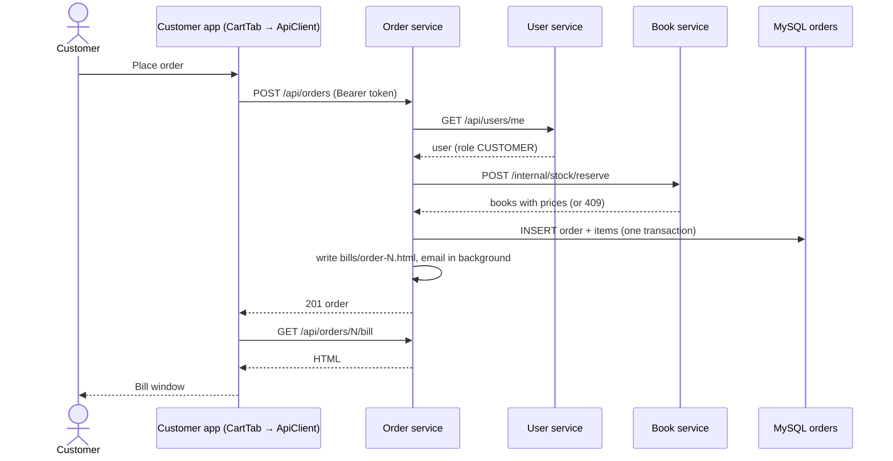

---

## 6. Requirements coverage

| Req | Where it's met | Checked by |
|---|---|---|
| FR1 login | `AccountService.login`, `LoginView` | `test_register_then_login`, `test_wrong_password_is_refused` |
| FR2 session until logout | `sessions` table, `/api/auth/logout`, every service checks via `/api/users/me` | `test_session_lasts_until_logout` |
| FR3 sign-up | `/api/auth/register`, `RegisterView` | `test_register_*` |
| FR4/FR5 search | `BookRepository.search`, `BrowseTab` | `test_search_*` |
| FR6/FR7 pick several, buy and/or rent in one order | `Cart`, `OrderService.place_order` | `test_buy_and_rent_in_one_order` |
| FR8/FR9 bill, saved as HTML | `billing`, `BillWindow` | `test_bill_is_saved_as_html` |
| FR10 email bill | `Notifier` (needs SMTP settings in `.env`) | Manual (video 4) |
| FR11 separate manager interface | `role` check at login; separate manager app | `test_customer_cannot_use_manager_app`, `test_manager_cannot_use_customer_app` |
| FR12/FR13 all orders, payment status | `GET /api/orders`, `PATCH …/payment`, manager `OrdersTab` | `test_manager_lists_and_marks_paid` |
| FR14 add/edit books | `POST/PUT /api/books`, `BooksTab`, `BookForm` | `test_manager_adds_and_edits_book` |
| N1 < 500 ms | Measured medians: token check 5 ms, search 13 ms, order history 37 ms. The user service pools its database connections (HikariCP); without the pool, every call paid ~80 ms to open a new connection. Each service logs every request with its time. | `test_search_answers_within_500ms` |
| N2 responsive client | `ApiClient` async + `Async` helper | Manual (video 2) |
| N3 bcrypt | `AccountService` (jBCrypt, cost 10) | Manual (video 1) |
| N4 token required | `require_login` on every protected route | `test_no_token_is_refused` |
| N5 own data only; roles kept apart | Role checks per route; `order_for` hides others' orders | `test_roles_are_kept_apart`, `test_order_history_shows_only_own_orders`, `test_customer_cannot_add_books` |
| Extra: profile + order history | `/api/users/me`, `/api/orders/mine`, `ProfileTab`, `OrdersTab` | `test_update_profile_and_password`, `test_order_history_shows_only_own_orders` |
| Extra: reviews and ratings | `/api/books/<id>/reviews`, `BrowseTab` | `test_review_updates_rating` |
| Extra: sales reports | `/api/reports/*`, `ReportsTab` | `test_sales_report_and_bestsellers` |
| Extra: modern GUI | JavaFX 21 | — |
| Rent (FR7) | `type` = RENT, due date, manager return | `test_return_rental_restocks` |

The 28 end-to-end tests run against the live services and real databases, with nothing faked
(`backend/tests`).
